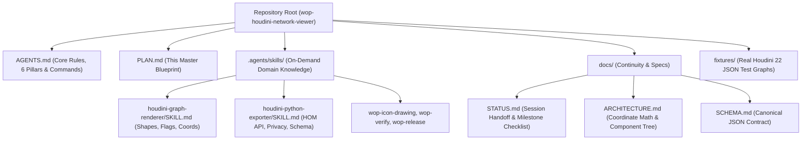

# In-Depth Architecture & Implementation Plan: WOP (`wop-houdini-network-viewer`)

> **Project Goal:** A lightweight, embeddable interactive Houdini node network viewer for portfolio websites, documentation, and technical blogs, inspired by [Klee](https://joined-forces.github.io/klee/) for Unreal Engine.
> **Repository Philosophy:** Agentic-first repository architecture enabling seamless development and handoffs across AI coding agents and human developers.

---

## 1. Core Project Pillars

Every architectural decision, code module and documentation file follows the six core pillars defined in [AGENTS.md](./AGENTS.md) section 1: usability, authenticity, strictly view-only, modularity and readability, documentation and style consistency, and compatibility. They are kept in that one place so they cannot drift.

---

## 2. Executive Summary & Core Requirements

### 2.1 Target Use Cases
1. **Portfolio Website Integration:** Technical Artists and Houdini TDs can replace static screenshots of node networks with interactive, zoomable, inspectable Houdini node graphs on their personal websites.
2. **Standalone Web Playground:** A hosted web application (GitHub Pages) where users can paste exported Houdini JSON directly from their clipboard (`Ctrl+V`), inspect networks, and generate embed snippets.
3. **Developer Package (`npm` & Web Component):** Easily installable via `npm install wop-houdini-network-viewer` for React/Next.js/Astro sites, via a single `<script>` tag (`<houdini-network>`) for plain HTML/WordPress/Cargo sites, or via `<iframe>` for ArtStation/Notion.

### 2.2 Locked-In Design Decisions (From Discovery & Live Houdini 22 Testing)
- **Interaction Mode:** **Strictly View-Only Layout** (`nodesDraggable={false}`, `nodesConnectable={false}`, `elementsSelectable={true}`). Visitors can pan, zoom, fit-to-view, use the minimap, toggle full-screen, click nodes to inspect parameters/VEX, and double-click subnetworks to dive inside, without mutating the artist's graph or node state.
- **Primary Context:** **SOPs (Surface Operators)** top-to-bottom data flow, including standard SOP flags (`Bypass`, `Lock`, `Template`, `Selectable Template`, `Display/Render`) rendered purely as visual indicators.
- **Houdini Python Shelf Exporter:**
  - Supports **both** copying JSON directly to the OS Clipboard (`hou.ui.copyTextToClipboard`) and saving a `.json` file to disk (`hou.ui.selectFile`).
  - Offers **both** Parameter Export modes via a quick prompt (`Compact: Modified Parms + VEX/Code` vs. `Full: All Visible Parms`).
  - **Smart Subnetwork Filtering:** Only recurses into subnets and unlocked HDAs (skipping internal built-in HDAs like `attribwrangle`'s internal VOP net or locked SideFX `labs::` internals, which reduces JSON size by >90%). Locked assets from anyone else stay closed unless the user confirms (owner decision 2026-10-27).
  - **Icons:** Built-in SideFX and Labs icons are never copied: the export names them and the viewer draws original icons. Only custom icons of assets outside the Houdini install and Labs are embedded (`opdef:...?IconSVG` via `hou.readFile()`), cleaned of editor metadata and deduplicated. The 36 built-in node shapes ship with the viewer; exporting custom shapes is an open item.
- **HUD & Overlay Controls:**
  - Full-Screen / Maximize toggle button.
  - Minimap (colored by actual Houdini node RGB values) + Fit-to-View & Zoom controls.
  - Debug / Raw Data Inspector (`Copy JSON` / `Download .json` button).
  - *(On Roadmap)* Node Search / Filter bar (`Ctrl+F`).

---

## 3. Agentic-Driven Repository Architecture

To ensure any AI coding agent (Antigravity, Claude Code, Cursor, Codex, Copilot) or human developer can immediately understand, build, test, and extend this repository without context bloat or regressions, the repository is structured around **Progressive Disclosure** and **Contract-Driven Development**.



### 3.1 File-by-File Repository Layout

```text
wop-houdini-network-viewer/
├── AGENTS.md                          # Always-on concise agent rules, 6 pillars, commands, definition of done
├── CLAUDE.md                          # One line: @AGENTS.md (for agents that look for their own file name)
├── SECURITY.md / CONTRIBUTING.md      # Vulnerability reports; rules for contributors
├── PLAN.md                            # This plan: architecture, milestones, roadmap
├── README.md                          # Human-facing documentation, quickstart, embed guide
├── CHANGELOG.md                       # Release notes per version
├── LICENSE                            # MIT License
├── package.json                       # npm package 'wop-houdini-network-viewer' and scripts
├── vite.config.ts                     # Playground build (dist-playground/), og:image URLs, dev-only reference icons
├── vite.lib.config.ts                 # npm + web component builds (dist/), stylesheet scoping, font files
├── eslint.config.js
├── tsconfig.json / tsconfig.lib.json  # Strict TypeScript for src and the npm types
├── .github/
│   ├── workflows/ci.yml               # Check, lint and builds on every push and pull request
│   ├── workflows/deploy-playground.yml # Builds the playground and publishes it to GitHub Pages
│   └── dependabot.yml                 # Weekly npm and GitHub Actions updates
│
├── .agents/skills/                    # On-demand agent knowledge (pointers in .claude/skills/)
│   ├── houdini-graph-renderer/SKILL.md
│   ├── houdini-python-exporter/SKILL.md
│   ├── wop-icon-drawing/SKILL.md
│   ├── wop-verify/SKILL.md            # Definition of done
│   └── wop-release/SKILL.md
│
├── docs/
│   ├── STATUS.md                      # Current state, owner steps, next tasks (short)
│   ├── HISTORY.md                     # Finished work and fidelity decisions
│   ├── ARCHITECTURE.md                # Coordinates, packaging, styles & isolation, navigation
│   ├── SCHEMA.md                      # JSON contract and its versioning policy
│   ├── ICON_ART_BIBLE.md              # Operator icon style, palette, legal rules
│   └── TESTERS.md                     # Guide for the tester release
│
├── exporter/                          # Houdini side (Python 3 / HOM)
│   ├── wop_exporter.py                # Export dialog, copy-for-web hotkey function, schema writer
│   ├── package/                       # Houdini package: wop.json + wop/ (shelf, icon, README.txt)
│   └── README.md                      # Install (package or manual shelf tool) and usage
│
├── fixtures/                          # Real Houdini 22 exports used as demos
│   ├── circuit_board-network.json     # Small /obj/circuit_board network
│   ├── circuit_gen-network.json       # Production network, full parameters
├── schema/wop-network-1.schema.json   # JSON Schema of the export format (all 1.x fields)
│
├── design/wop-icon/                   # Master WOP icon SVG, web.html preview and pack/ (website icon pack)
├── public/                            # Playground static files (favicons, manifest, og-image);
│                                      #   downloads/ is generated (exporter zip and script)
├── scripts/                           # build_exporter_package.mjs (exporter zip), print_sri.mjs (release hash),
│                                      #   build_wop_icon_pack.py (website icons), build_local_reference_icons.py
│                                      #   (dev-only SideFX reference icons, Labs catalog), icon prototype builders
├── local-refs/                        # Gitignored SideFX reference icons, served by the dev server only
│
└── src/
    ├── index.ts                       # npm entry: <HoudiniNetwork />, <RemoteHoudiniNetwork />, types, converter
    ├── web-component.ts               # <houdini-network> custom element (Shadow DOM)
    ├── embed/                         # Shared by the web component and the ?embed=true page
    │   ├── embedAttributes.ts         # Attribute / URL parameter names -> viewer options
    │   ├── fetchNetwork.ts            # Downloads a network .json with readable errors
    │   └── RemoteHoudiniNetwork.tsx   # Viewer that loads its network from a URL
    ├── styles/                        # theme, fonts, scoped reset, viewer, bundles (see ARCHITECTURE.md section 5)
    ├── schema/
    │   ├── types.ts                   # Canonical TypeScript interfaces of the JSON contract
    │   ├── converter.ts               # Public re-exports of the three modules below
    │   ├── normalize.ts               # Checks and repairs untrusted input, schema version guard
    │   ├── convertGraph.ts            # One level -> React Flow nodes & edges (Y inversion, scaling, IDs)
    │   ├── colors.ts                  # Houdini RGB -> CSS
    │   ├── subnetPath.ts              # Subnetwork dive path -> stack of network levels
    │   ├── connectedWires.ts          # Wires attached to the selected node (through dots)
    │   └── operatorType.ts            # Namespace / name / version of operator types
    ├── components/
    │   ├── HoudiniNetwork.tsx         # React Flow wrapper: parsing, error boundaries, keyboard access, layout
    │   ├── hooks/                     # useFullscreen, useNavigationHistory, useViewerHotkeys, useWireHighlight, ...
    │   ├── theme.ts                   # Shared canvas colors
    │   ├── NetworkErrorBoundary.tsx   # Render errors -> error panel
    │   ├── hud/                       # Path bar, toolbar, network overview, loading / error states
    │   ├── inspector/                 # Read-only Parameter Pane: layout model, rows, ramps, code, resizable panel
    │   ├── nodes/
    │   │   ├── HoudiniSopNode.tsx     # Node: shape, flags, icon, label, connectors, badges
    │   │   ├── HoudiniDotNode.tsx / HoudiniSubnetInput.tsx / HoudiniNetBox.tsx / HoudiniStickyNote.tsx
    │   │   ├── shapes/                # Houdini 22 NodeShapes data and helpers
    │   │   └── icons/                 # Original operator icons: registry, sop/, labs/, path/
    │   └── edges/
    │       ├── HoudiniWire.tsx        # Wire edge (constant on-screen width, selection highlight)
    │       └── wirePaths.ts           # Houdini's "default" and "rounded" wire routing
    └── playground/                    # Hosted web app (GitHub Pages)
        ├── App.tsx                    # Demos, open / drop / paste a .json, header buttons
        ├── PlaygroundDialog.tsx       # Shared <dialog> frame
        ├── EmbedDialog.tsx            # Embed code generator (web component, React, iframe)
        ├── ExporterDialog.tsx         # Exporter download and install steps
        ├── FeedbackDialog.tsx         # Tester feedback form (sendFeedback.ts, Web3Forms)
        ├── EmbedView.tsx              # ?embed=true full-page viewer for iframes
        ├── IconReviewGallery.tsx      # Icon review tool (dev server only)
        └── main.tsx                   # Entry: lazy-loads the playground or the embed view
```

---

## 4. Technical Specification & Solutions to Real-World Houdini Edge Cases

Based on our live diagnostic dump of `/obj/circuit_board/circuit_gen` from **Houdini 22.0.466**, the following technical rules are mandatory in our implementation:

### 4.1 Coordinate System & Layout Math (`src/schema/converter.ts`)
Houdini's Network Editor uses a **Cartesian coordinate system** (`+Y` is UP) measured in network units. The browser uses **Screen coordinates** (`+Y` is DOWN) in pixels (`px`). The constants live in `src/schema/convertGraph.ts`; ARCHITECTURE.md section 3 has the full table.

- **Scale Constant:** `HOUDINI_UNIT_TO_PX = 100`.
- **Standard Nodes (`HoudiniSopNode`, `HoudiniSubnetInput`):**
  - In Houdini, `node.position()` is the bottom-left corner of the node body. `hou.Node.size()` reports `[1.1296, 0.2824]`, but Houdini draws nodes with the 10:3 shape box, so the viewer always uses `100px x 30px` (`node.size` is informational).
  - `screenX = node.pos[0] * 100`
  - `screenY = -(node.pos[1] + 0.3) * 100`
- **Network Dots (`HoudiniDotNode`):**
  - Centered at `dot.pos`:
  - `screenX = dot.pos[0] * 100 - 9.5`, `screenY = -dot.pos[1] * 100 - 9.5` (`HOUDINI_DOT_RADIUS_PX = 9.5`)
- **Network Boxes & Sticky Notes (`HoudiniNetBox`, `HoudiniStickyNote`):**
  - In Houdini, `box.position()` is the **bottom-left** corner (`minX, minY`) and `box.size()` is `[width, height]`.
  - When **expanded** (`minimized: false`):
    - `widthPx = box.size[0] * UNIT_SCALE`
    - `heightPx = box.size[1] * UNIT_SCALE`
    - `screenX = box.pos[0] * UNIT_SCALE`
    - `screenY = -(box.pos[1] + box.size[1]) * UNIT_SCALE`
  - When **minimized** (`minimized: true`, e.g., `__netbox2` `"OLD_LOOP"` where `size` becomes `[2.5, 0.0]`):
    - Render a compact header bar of height `29px` (`MINIMIZED_BOX_HEIGHT_PX`) at `screenY = -box.pos[1] * 100 - 29`, and hide child nodes belonging to that minimized box (`box.items`) so they do not float around outside it.
  - Expanded boxes also draw the 29px header above the body Houdini reports (Houdini fits `pos` / `size` around the items only).

### 4.2 Node Shapes (`src/components/nodes/shapes/nodeShapes.ts`)
From our live dump, Houdini uses `"shape": ""` (normalized to `"rect"`) for standard nodes, plus specialized shapes for key operators:
- `rect`: Standard rounded rectangle pill (`box`, `xform`, `polyextrude`, etc.)
- `wave`: Attribute Wrangle (`attribwrangle`) wavy bottom/top contour
- `cigar`: Merge (`merge`) stadium/capsule shape
- `diamond`: Switch (`switch`) diamond shape
- `null`: Null (`null`) framed bracket/crossbar shape
- `chevron_down` & `chevron_up`: For-Each Loop Begin (`block_begin`) & End (`block_end`)
- `tilted`: Attribute Promote (`attribpromote`) slanted parallelogram
- `circle`, `bone`, `cloud`, `bulge`, `star` and the rest of Houdini 22's 36 built-in shapes (`houdiniShapesData.json`).
- Custom shapes: the viewer can draw shape definitions from the document's `customShapes`, but the exporter does not fill it yet, so user-made shapes fall back to `rect` (open item, see the roadmap).

### 4.3 Input/Output Connectors & The `maxInputs: 9999` Rule
- **Standard Nodes (`maxInputs <= 4`):**
  - Render `maxInputs` distinct connector handles evenly spaced across the top edge of the node (e.g., `attribwrangle` has 4 inputs; `edit` has 2 inputs; `box` has 1 input).
  - Hovering a connector displays its Houdini label (`inputLabels[i]`, e.g., `"Geometry to Process with Wrangle"`).
- **Dynamic Multi-Input Nodes (`maxInputs > 4`, such as `merge` or `switch` where `maxInputs == 9999`):**
  - Render a **single wide multi-input pill bar** centered at the top of the node. All incoming wires (`toInput: 0, 1, 2, ...`) attach cleanly to this bar without spawning thousands of DOM handles.
- **Subnetwork Indirect Inputs (`subnetInputs`):**
  - In Houdini, wires coming from a parent network's input connectors have `"from": "1"`, `"from": "2"`, etc., matching `subnetInputs[i].name`.
  - Our converter normalizes these IDs to `input:1`, etc. (boxes, stickies and dots get `box:`, `sticky:`, `dot:`), so they never collide with node names and wire seamlessly from the top indirect input triangles.

### 4.4 Smart Subnetwork Recursion & Parameter Extraction (`exporter/wop_exporter.py`)
1. **Avoiding the 3MB Built-In HDA Trap:**
   - Many standard Houdini SOPs (`attribwrangle`, `color`, `split`, `convertline`, `labs::*`) return `True` for `node.isSubNetwork()`.
   - Our exporter checks a helper `should_recurse_subnet(node)`:
     - Returns `True` for user containers: `subnet`, `geo`, `dopnet`, `topnet`, `lopnet`, `objnet`.
     - Returns `False` for built-in containers that are not digital assets at all (`type().definition() is None`, for example Attribute VOP or Solver SOP: engine internals, not user networks).
     - Returns `True` for any unlocked asset (the user is editing it), and `False` for locked SideFX and Labs assets.
     - Returns `include_locked_assets` for other locked assets (purchased, studio, colleagues'): `False` unless the user chose "Include Insides" in the export dialog.
2. **Safe Parameter & Expression Extraction:**
   - Iterates over `node.parmTuples()` so vector parameters (`tx, ty, tz` -> `Translate`) stay grouped as a single tuple row.
   - Wraps `p.expression()` in `try...except hou.OperationFailed:` because Houdini throws an exception when querying `.expression()` on time-dependent parameters that have `0` or `>1` keyframes.
   - Supports **Compact Mode** (only non-default parameter tuples + code snippets like `snippet` / `python`) and **Full Mode** (all visible non-hidden parameter tuples organized by folder tabs).
3. **Deduplicated Icon Dictionary (`"icons": { ... }`):**
   - Built-in SideFX and Labs icons are **never copied**: the document only names them (`node.icon`) and the viewer draws its own original icons (see `docs/ICON_ART_BIBLE.md`).
   - Only icons of the user's own digital assets are embedded, read with `hou.readFile()` (`opdef:...?IconSVG`), and stored once in the top-level `"icons"` dictionary so many nodes of one asset share one SVG.
4. **Path scrubbing:** project and Houdini folders become `$HIP`, `$JOB`, `$HOUDINI_USER_PREF_DIR`, `$HSITE` or `$HFS`; every other absolute path keeps only its file name (`<path>/rock.exr`). See SCHEMA.md rule 7.

---

## 5. Phased Implementation Roadmap

### Milestone 1: Repository Scaffolding, Agentic Docs & Fixtures
- Initialize `package.json` (`wop-houdini-network-viewer`), TypeScript, Vite, Tailwind CSS, `@xyflow/react`, and Lucide icons.
- Create `AGENTS.md`, `PLAN.md`, `docs/STATUS.md`, `docs/ARCHITECTURE.md`, and `docs/SCHEMA.md` enforcing the Core Pillars (5 at the time, now 6) and neutral international documentation styling.
- Create `.agents/skills/houdini-graph-renderer/SKILL.md` and `.agents/skills/houdini-python-exporter/SKILL.md`.
- Write the production-ready `exporter/wop_exporter.py` shelf tool (with the UI dialog for Clipboard vs. File Save and Compact vs. Full parameters) and `exporter/README.md`.
- Process `complex-network.json` into clean, fast-loading test fixtures (now `fixtures/circuit_gen-network.json` and `fixtures/circuit_board-network.json`, re-exported from Houdini 22).
- Implement the canonical TypeScript schema (`src/schema/types.ts`) and verify `npm run check` passes.

### Milestone 2: Core Network Canvas & Authentic Houdini Nodes
- Implement `src/schema/converter.ts` (coordinate inversion, box bottom-left alignment, minimized box item filtering, subnet input normalization).
- Build `<HoudiniSopNode />` (strictly view-only):
  - Authentic Houdini node body SVG shapes (`rect`, `wave`, `cigar`, `diamond`, `null`, `chevron_up`, `chevron_down`, `tilted`, `circle`).
  - Left flag bar (`Bypass` yellow, `Lock` red) and Right flag bar (`Template` pink, `Display/Render` blue) as non-editable visual status indicators.
  - Embedded SVG icon rendering + crisp fallback icons.
  - Floating right-side node name label, descriptive badge, and `showComment` text.
  - Top/bottom input/output connectors (1-4 discrete slots vs. `>4` wide multi-input bar).
- Build `<HoudiniWire />`, `<HoudiniDotNode />`, `<HoudiniSubnetInput />`, `<HoudiniNetBox />` (expanded & minimized), and `<HoudiniStickyNote />`.
- Build `<HoudiniNetwork />` with strictly locked view-only layout, Houdini dark grid background, color-coded Minimap, Fit-to-View, Full-Screen toggle, and Debug JSON copy/download button.

### Milestone 3: Parameter & VEX Inspector, Subnetwork Navigation & Packaging
- Build `<ParameterInspector />` read-only side-drawer:
  - Opens when clicking any node on the canvas.
  - Displays node header (Icon, Name, Operator Type, Flags, Comment).
  - Highlights **VEXpression (`snippet`)** and Python code blocks with syntax highlighting and a 1-click Copy Code button.
  - Displays grouped parameter tuples (`Translate`, `Run Over`, etc.) with channel expression badges (green/cyan highlight when driven by `ch(...)` or `$F`, matching Houdini).
- Build `<BreadcrumbBar />` & Subnetwork Diving:
  - Double-clicking a Subnet node (`children` present) dives into that child network and updates the top breadcrumb bar (`/obj/circuit_board/circuit_gen/subnetwork1`).
- Build the **Playground Web App** (Paste JSON from clipboard, Drag & Drop `.json` file, switch between sample networks, and copy Embed Code) + **NPM & Web Component (`<houdini-network>`) Build Pipeline**.


### Status (2026-10-27)

Milestones 1 to 3 are complete (details in `docs/STATUS.md`). The roadmap below was sorted by the owner on 2026-10-27 into the tester release, Milestone 4, open items for later, and cut items.

### Tester Release (`0.1.0-alpha.1`)

Goal: a hosted playground that a small group of selected Houdini users can open, install the exporter from, try with their own networks, and send feedback from. Not published on npm (npm packages are public, so npm is the public launch in Milestone 4).

- Version control (git repository, private or public GitHub repository).
- Host the playground on GitHub Pages (`.github/workflows/deploy-playground.yml`), kept out of search engines (`noindex`) during testing.
- Exporter download in the playground, installed as a Houdini package (`exporter/package/`, built into `wop-exporter.zip`).
- Hide the internal Icon Review tab from the hosted playground.
- Version `0.1.0-alpha.1`, CHANGELOG entry, matching README snippet.
- Feedback form that sends testers' messages to the owner's email (Web3Forms), plus the tester guide `docs/TESTERS.md`.
- Absolute `og:image` URL for link previews.
- Scope the npm stylesheet to the viewer, so it cannot clash with a host page's Tailwind.
- Schema versioning policy (`docs/SCHEMA.md` section 3) and a viewer guard for newer major versions.
- This plan rewritten with the roadmap.
- Owner steps: re-export the demo networks with schema 1.3.0, check one real export for private data, smoke-test Safari, Firefox and a real phone.

### Milestone 4: Quality, Public Release & Viewer Features

**Quality** (done 2026-10-27 with the review fixes, see `docs/HISTORY.md`)
- [x] Lint setup with the React hooks and JSX accessibility rules.
- [x] CI on GitHub Actions: check, lint and both builds on every push and pull request.
- [ ] Automated tests (unit, component, exporter and browser tests): later.
- [ ] React 19 smoke test, then widen the peer range to `^18.2.0 || ^19.0.0`.
- [ ] Measure `preact/compat` for the web component build (smaller bundle).

**Public release**
- Publish `wop-houdini-network-viewer` on npm (and so on jsDelivr for the web component), after the tester feedback.
- [x] `repository`, `homepage` and `bugs` fields in `package.json`.
- Set `PUBLISHED_ON_NPM` in the Embed dialog and drop the README's "not on npm yet" note; publish the SRI hash (`npm run sri`).
- Embedding guide: CORS, file size, where to host the JSON.
- Remove the tester-phase `noindex` from `index.html`.

**Viewer**
- Node search (`Ctrl+F`): find a node by name or type and frame it, including inside subnetworks.
- Links to a subnetwork or node: a share link or embed option that opens a given subnetwork with a node selected.
- Save the view as PNG or SVG.
- Multiparm blocks with instance count (needs a Houdini reference screenshot).

**Exporter**
- Run the exporter on Houdini 20.5 and 21 (needs those installs).

### Open for Later (no date)

- Keyboard and screen-reader support: done 2026-10-27 (Tab to nodes, Enter opens the inspector, labelled rows, reduced motion). Still open: moving between nodes with arrow keys along the wires.
- Decide what other contexts show (VOP, LOP, TOP, DOP), then VOP networks with side connectors, and the OBJ / LOP / TOP flag sets.
- Export custom node shapes (`customShapes`).
- Large networks: done 2026-10-27 for levels with more than 1,000 items (`onlyRenderVisibleElements`) and lazy demos. Still open: a performance budget test with a generated 5,000-node network.
- Path bar history dropdowns and jump menu.
- Houdini light color scheme.
- Upload and share service (short links, like Klee): needs a server, storage and moderation.

### Cut

- Usage analytics on the hosted playground (ask testers directly instead).
- Keyframe colors in the Parameter Pane (no reference screenshot planned).
- Verifying sticky notes against a real export.

---

## 6. Verification & Acceptance Criteria
- **Automated Checks:** the definition of done in AGENTS.md: `check`, `lint`, `build` and `build:lib`. CI runs them on every push.
- **Real Production Graph Verification:** the 169-node `circuit_gen` network renders in the browser with accurate spatial layout, wire dots, For-Each chevrons, wavy Wrangle shapes, cigar Merge shapes, expanded/minimized Network Boxes, and clickable VEX inspection.
- **Library isolation:** on a host page with its own utility classes, the npm build styles only the viewer and the host's elements stay untouched.
