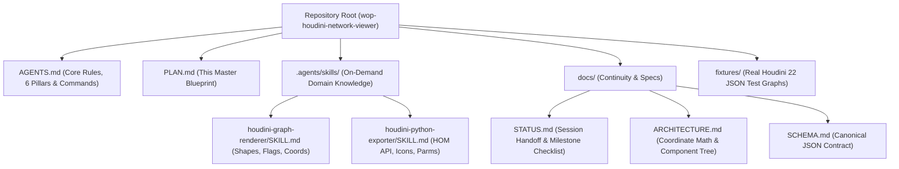

# In-Depth Architecture & Implementation Plan: WOP (`wop-houdini-network-viewer`)

> **Project Goal:** A lightweight, embeddable interactive Houdini node network viewer for portfolio websites, documentation, and technical blogs, inspired by [Klee](https://joined-forces.github.io/klee/) for Unreal Engine.
> **Repository Philosophy:** Agentic-first repository architecture enabling seamless development and handoffs across AI coding agents and human developers.

---

## 1. Core Project Pillars

Every architectural decision, code module, and documentation file in this repository must adhere to six core pillars:

1. **Usability (Klee-Level Frictionless Workflow):**
   - Users must have as few steps as possible to get a Houdini network onto their own website.
   - Exporting from Houdini is a 1-click Shelf action, and embedding into a website works via a single HTML tag (`<houdini-network>`), a single React component (`<HoudiniNetwork />`), or an `<iframe>` link.
2. **Authenticity (1:1 Houdini Look & Feel):**
   - Node networks must look and feel like Houdini's native Network Editor: exact node proportions, authentic vector shapes, left/right flag bars, wire tangents, dark grid background, and Houdini color tokens.
   - Whenever visual details are ambiguous, ask the user for Houdini reference screenshots rather than guessing.
3. **Strictly View-Only (Pure Visualization):**
   - The library is strictly a read-only visualization tool, not a reimplementation of Houdini or a graph editor.
   - Website visitors cannot drag nodes out of place, rewire connections, toggle flags to mutate state, or edit parameter values. Interaction is strictly for navigation (pan, zoom, fit view, fullscreen, dive into subnetworks) and inspection (selecting nodes to view parameters and VEX code).
4. **Modularity & Readability:**
   - Code must be simple, modular, and easy for both humans and AI agents to read.
   - Follow modern TypeScript, React, and `@xyflow/react` conventions: small single-responsibility files, strict type definitions, pure data transformation functions, and zero unnecessary abstractions.
5. **Documentation & Style Consistency:**
   - Every feature, schema field, and public module must be consistently documented.
   - **Prose & Comment Convention:** Use neutral, international English styling. Do not use em-dashes (long dashes) in prose, documentation, UI text, or code comments; use standard hyphens (`-`), colons (`:`), parentheses, or separate sentences instead.
   - Use concise TSDoc (`/** ... */`) comments on exported types, functions, and components explaining purpose and coordinate/unit assumptions.
6. **Compatibility (Mobile & Cross-Browser):**
   - Base layout and display settings must be compatible with Android and iOS views: responsive layout down to phone widths, touch pan and pinch-zoom, finger-sized tap targets, no hover-only interactions, and safe-area awareness in fullscreen.
   - The repository must work in current versions of the major modern browsers (Chrome, Edge, Firefox, Safari, desktop and mobile) and must not depend on obscure, experimental, flag-gated, or vendor-prefix-only APIs and CSS. Use broadly supported (Baseline) features and feature-detect with graceful fallbacks where support differs.

---

## 2. Executive Summary & Core Requirements

### 2.1 Target Use Cases
1. **Portfolio Website Integration:** Technical Artists and Houdini TDs can replace static screenshots of node networks with interactive, zoomable, inspectable Houdini node graphs on their personal websites.
2. **Standalone Web Playground:** A hosted web application (GitHub Pages) where users can paste exported Houdini JSON directly from their clipboard (`Ctrl+V`), inspect networks, and generate embed snippets.
3. **Developer Package (`npm` & Web Component):** Easily installable via `npm install wop-houdini-network-viewer` for React/Next.js/Astro sites, via a single `<script>` tag (`<houdini-network>`) for plain HTML/WordPress/Cargo sites, or via `<iframe>` for ArtStation/Notion.

### 2.2 Locked-In Design Decisions (From Discovery & Live Houdini 22 Testing)
- **Interaction Mode:** **Strictly View-Only Layout** (`nodesDraggable={false}`, `nodesConnectable={false}`, `elementsSelectable={true}`). Visitors can pan, zoom, fit-to-view, use the minimap, toggle full-screen, click nodes to inspect parameters/VEX, and double-click subnetworks to dive inside, without mutating the artist's graph or node state.
- **Primary Context:** **SOPs (Surface Operators)** top-to-bottom data flow, including standard SOP flags (`Bypass`, `Lock`, `Template`, `Selectable Template`, `Display/Render`) rendered purely as visual indicators.
- **Houdini Python Shelf Exporter:**
  - Supports **both** copying JSON directly to the OS Clipboard (`hou.ui.copyTextToClipboard`) and saving a `.json` file to disk (`hou.ui.selectFile`).
  - Offers **both** Parameter Export modes via a quick prompt (`Compact: Modified Parms + VEX/Code` vs. `Full: All Visible Parms`).
  - **Smart Subnetwork Filtering:** Only recurses into user-authored Subnets and custom HDAs (skipping internal built-in HDAs like `attribwrangle`'s internal VOP net or locked SideFX `labs::` internals, which reduces JSON size by >90%).
  - **Icon & Shape Extraction:** Extracts deduplicated SVG icons (from both `$HFS/houdini/config/Icons/icons.zip` and `opdef:...?IconSVG` virtual paths via `hou.readFile()`) and custom node shape definitions (`$HFS/houdini/config/NodeShapes/*.json`), paired with clean procedural fallbacks in the web renderer.
- **HUD & Overlay Controls:**
  - Full-Screen / Maximize toggle button.
  - Minimap (colored by actual Houdini node RGB values) + Fit-to-View & Zoom controls.
  - Debug / Raw Data Inspector (`Copy JSON` / `Download .json` button).
  - *(On Roadmap)* Node Search / Filter bar (`Ctrl+F`).

---

## 3. Agentic-Driven Repository Architecture

To ensure any AI coding agent (Antigravity, Claude Code, Cursor, Codex, Copilot) or human developer can immediately understand, build, test, and extend this repository without context bloat or regressions, the repository is structured around **Progressive Disclosure** and **Contract-Driven Development**.



### 3.1 File-by-File Repository Layout

```text
wop-houdini-network-viewer/
├── AGENTS.md                          # Always-on concise agent rules, 6 pillars & commands (<150 lines)
├── PLAN.md                            # Complete architectural & phased implementation plan
├── README.md                          # Human-facing documentation, quickstart, and portfolio embed guide
├── LICENSE                            # MIT License
├── package.json                       # NPM package config (unscoped 'wop-houdini-network-viewer')
├── tsconfig.json                      # Strict TypeScript configuration
├── vite.config.ts                     # Playground app build config (output: dist-playground/)
├── vite.lib.config.ts                 # NPM Library & Web Component bundle build config (output: dist/)
├── tsconfig.lib.json                  # Type declarations for the npm package (dist/types/)
│
├── .agents/                           # Agentic Customizations (discovered automatically)
│   └── skills/
│       ├── houdini-graph-renderer/
│       │   └── SKILL.md               # Visual specs: Houdini coordinate math, node shapes, flag colors, wires
│       └── houdini-python-exporter/
│           └── SKILL.md               # HOM Python rules: safe_expr, HDA recursion filtering, icon zip/opdef extraction
│
├── docs/                              # Deep-Dive Documentation for Humans & Agents
│   ├── STATUS.md                      # Living progress tracker & session-to-session handoff log
│   ├── ARCHITECTURE.md                # Technical decisions, coordinate transforms, Shadow DOM encapsulation
│   └── SCHEMA.md                      # JSON Schema documentation & edge cases discovered from Houdini 22
│
├── exporter/                          # Houdini Side (Python 3 / HOM)
│   ├── wop_exporter.py    # Complete shelf tool script (Clipboard + File save, Compact + Full parms)
│   └── README.md                      # 30-second installation guide for Houdini shelves
│
├── fixtures/                          # Real Houdini 22.0 Test Networks
│   ├── circuit_board-network.json     # Small /obj/circuit_board network (Curve, Transform with an expression, Bend, Output)
│   └── circuit_gen-network.json       # Production network, full parameters (Wrangles, Loops, Dots, NetBoxes, Subnets, Ramps)
│
└── src/
    ├── index.ts                       # Library entry point: exports <HoudiniNetwork />, types, and utilities
    ├── web-component.ts               # Custom Element (<houdini-network>) with Shadow DOM isolation
    ├── embed/                         # Shared by the web component and the ?embed=true page
    │   ├── embedAttributes.ts         # Attribute / URL parameter names -> viewer options
    │   ├── fetchNetwork.ts            # Downloads a network .json with readable errors
    │   └── RemoteHoudiniNetwork.tsx   # Viewer that loads its network from a URL
    ├── styles/                        # Library and playground stylesheets (see docs/ARCHITECTURE.md section 5)
    ├── schema/
    │   ├── types.ts                   # Canonical TypeScript interfaces (HoudiniNetworkDocument, HoudiniNodeData, etc.)
    │   ├── converter.ts               # Converts Houdini JSON -> React Flow Nodes & Edges (handles Y-inversion & scaling)
    │   └── subnetPath.ts              # Subnetwork dive path -> stack of network levels
    ├── components/
    │   ├── HoudiniNetwork.tsx         # Main React Flow wrapper, view-only layout, HUD controls, fullscreen & minimap
    │   ├── hud/
    │   │   ├── BreadcrumbBar.tsx      # Subnet path navigation (/obj/circuit_board/circuit_gen)
    │   │   └── ViewerToolbar.tsx      # Fullscreen toggle, Fit View, Debug JSON download/copy
    │   ├── inspector/
    │   │   ├── ParameterInspector.tsx # Houdini Parameter Pane drawer (header, flags, comment, grouped parms)
    │   │   ├── ParmLayoutView.tsx     # Tab bars and section folders
    │   │   ├── ParmLine.tsx           # One pane row: gutter toggle, label, read-only widgets
    │   │   ├── ResizableInspectorPanel.tsx # Side panel / bottom sheet with a drag handle
    │   │   ├── paneStyles.ts          # Parameter Pane colors sampled from Houdini 22
    │   │   ├── CodeBlock.tsx          # VEX / Python code field with Copy button
    │   │   ├── codeHighlight.ts       # Lightweight VEX / Python tokenizer
    │   │   └── parmModel.ts           # Exported parm tuples -> layout tree (tabs, sections, joined lines)
    │   ├── nodes/
    │   │   ├── HoudiniSopNode.tsx     # 1:1 Houdini SOP node (SVG shapes, left/right flags, icon, label, connectors)
    │   │   ├── HoudiniDotNode.tsx     # Wire routing dot (hou.NetworkDot)
    │   │   ├── HoudiniSubnetInput.tsx # Indirect Subnet Input pill (#1..4 at top of subnet graphs)
    │   │   ├── HoudiniNetBox.tsx      # Background Network Box (supports expanded & minimized states)
    │   │   ├── HoudiniStickyNote.tsx  # Background Sticky Note
    │   │   └── shapes/
    │   │       └── nodeShapes.ts      # Built-in SVG path generators (rect, wave, cigar, diamond, chevron_up/down, null, tilted) + custom shape renderer
    │   └── edges/
    │       └── HoudiniWire.tsx        # Authentic Houdini cubic Bezier wire & multi-input slot routing
    └── playground/                    # Standalone Web App (GitHub Pages / Klee-style interface)
        ├── App.tsx                    # Demo switcher, Open / Paste / drop a .json, Embed button
        ├── EmbedDialog.tsx            # Embed code generator (HTML web component, React, iframe)
        ├── EmbedView.tsx              # ?embed=true full-page viewer for iframes
        └── main.tsx                   # App entry point (lazy-loads the playground or the embed view)
```

---

## 4. Technical Specification & Solutions to Real-World Houdini Edge Cases

Based on our live diagnostic dump of `/obj/circuit_board/circuit_gen` from **Houdini 22.0.466**, the following technical rules are mandatory in our implementation:

### 4.1 Coordinate System & Layout Math (`src/schema/converter.ts`)
Houdini's Network Editor uses a **Cartesian coordinate system** (`+Y` is UP) measured in network units where a standard SOP node is `1.1296 x 0.2824` units. The browser uses **Screen coordinates** (`+Y` is DOWN) in pixels (`px`).

- **Scale Constant:** `UNIT_SCALE = 100` (so a standard SOP node is `~113px x 28px`).
- **Standard Nodes (`HoudiniSopNode`, `HoudiniSubnetInput`):**
  - In Houdini, `node.position()` is the bottom-left corner of the node body.
  - `screenX = node.pos[0] * UNIT_SCALE`
  - `screenY = -(node.pos[1] + node.size[1]) * UNIT_SCALE`
- **Network Dots (`HoudiniDotNode`):**
  - Centered at `dot.pos`:
  - `screenX = dot.pos[0] * UNIT_SCALE - DOT_RADIUS`
  - `screenY = -dot.pos[1] * UNIT_SCALE - DOT_RADIUS`
- **Network Boxes & Sticky Notes (`HoudiniNetBox`, `HoudiniStickyNote`):**
  - In Houdini, `box.position()` is the **bottom-left** corner (`minX, minY`) and `box.size()` is `[width, height]`.
  - When **expanded** (`minimized: false`):
    - `widthPx = box.size[0] * UNIT_SCALE`
    - `heightPx = box.size[1] * UNIT_SCALE`
    - `screenX = box.pos[0] * UNIT_SCALE`
    - `screenY = -(box.pos[1] + box.size[1]) * UNIT_SCALE`
  - When **minimized** (`minimized: true`, e.g., `__netbox2` `"OLD_LOOP"` where `size` becomes `[2.5, 0.0]`):
    - Render a compact header bar of height `28px` at `screenY = -box.pos[1] * UNIT_SCALE - 28`, and hide child nodes belonging to that minimized box (`box.items`) so they do not float around outside it.

### 4.2 Node Shapes (`src/components/nodes/shapes/nodeShapes.ts`)
From our live dump, Houdini uses `"shape": ""` (normalized to `"rect"`) for standard nodes, plus specialized shapes for key operators:
- `rect`: Standard rounded rectangle pill (`box`, `xform`, `polyextrude`, etc.)
- `wave`: Attribute Wrangle (`attribwrangle`) wavy bottom/top contour
- `cigar`: Merge (`merge`) stadium/capsule shape
- `diamond`: Switch (`switch`) diamond shape
- `null`: Null (`null`) framed bracket/crossbar shape
- `chevron_down` & `chevron_up`: For-Each Loop Begin (`block_begin`) & End (`block_end`)
- `tilted`: Attribute Promote (`attribpromote`) slanted parallelogram
- `circle`, `bone`, `cloud`, `bulge`, `star`: Standard Houdini palette shapes + dynamic rendering of any custom JSON shape extracted from `$HFS/houdini/config/NodeShapes/`.

### 4.3 Input/Output Connectors & The `maxInputs: 9999` Rule
- **Standard Nodes (`maxInputs <= 4`):**
  - Render `maxInputs` distinct connector handles evenly spaced across the top edge of the node (e.g., `attribwrangle` has 4 inputs; `edit` has 2 inputs; `box` has 1 input).
  - Hovering a connector displays its Houdini label (`inputLabels[i]`, e.g., `"Geometry to Process with Wrangle"`).
- **Dynamic Multi-Input Nodes (`maxInputs > 4`, such as `merge` or `switch` where `maxInputs == 9999`):**
  - Render a **single wide multi-input pill bar** centered at the top of the node. All incoming wires (`toInput: 0, 1, 2, ...`) attach cleanly to this bar without spawning thousands of DOM handles.
- **Subnetwork Indirect Inputs (`subnetInputs`):**
  - In Houdini, wires coming from a parent network's input connectors have `"from": "1"`, `"from": "2"`, etc., matching `subnetInputs[i].name`.
  - Our converter normalizes these IDs to `__subnet_input_1`, etc., so they never collide with node names and wire seamlessly from the top indirect input triangles.

### 4.4 Smart Subnetwork Recursion & Parameter Extraction (`exporter/wop_exporter.py`)
1. **Avoiding the 3MB Built-In HDA Trap:**
   - Many standard Houdini SOPs (`attribwrangle`, `color`, `split`, `convertline`, `labs::*`) return `True` for `node.isSubNetwork()`.
   - Our exporter checks a helper `should_recurse_subnet(node)`:
     - Returns `True` if `node.type().name() in ("subnet", "geo", "dopnet", "topnet", "lopnet")` OR if the node is an unlocked HDA (`not node.isLockedHDA()`) OR belongs to a custom user namespace (non-SideFX/Labs HDA library path).
     - Returns `False` for built-in SideFX/Labs atomic SOP wrappers.
2. **Safe Parameter & Expression Extraction:**
   - Iterates over `node.parmTuples()` so vector parameters (`tx, ty, tz` -> `Translate`) stay grouped as a single tuple row.
   - Wraps `p.expression()` in `try...except hou.OperationFailed:` because Houdini throws an exception when querying `.expression()` on time-dependent parameters that have `0` or `>1` keyframes.
   - Supports **Compact Mode** (only non-default parameter tuples + code snippets like `snippet` / `python`) and **Full Mode** (all visible non-hidden parameter tuples organized by folder tabs).
3. **Deduplicated Icon Dictionary (`"icons": { ... }`):**
   - For every unique `node.type().icon()` in the exported graph:
     - First attempts `hou.readFile(icon_name)` (which resolves `opdef:/labs::Sop/...?IconSVG` directly).
     - Next checks `$HFS/houdini/config/Icons/icons.zip` (converting `"SOP_polyextrude-2.0"` -> `"SOP/polyextrude.svg"` if the versioned name is not found).
     - Stores the raw `<svg>...</svg>` string once in a top-level `"icons"` dictionary in the JSON so 50 `attribwrangle` nodes share 1 SVG definition.

---

## 5. Phased Implementation Roadmap

### Milestone 1: Repository Scaffolding, Agentic Docs & Fixtures
- Initialize `package.json` (`wop-houdini-network-viewer`), TypeScript, Vite, Tailwind CSS, `@xyflow/react`, and Lucide icons.
- Create `AGENTS.md`, `PLAN.md`, `docs/STATUS.md`, `docs/ARCHITECTURE.md`, and `docs/SCHEMA.md` enforcing the 5 Core Pillars and neutral international documentation styling.
- Create `.agents/skills/houdini-graph-renderer/SKILL.md` and `.agents/skills/houdini-python-exporter/SKILL.md`.
- Write the production-ready `exporter/wop_exporter.py` shelf tool (with the UI dialog for Clipboard vs. File Save and Compact vs. Full parameters) and `exporter/README.md`.
- Process `complex-network.json` into clean, fast-loading test fixtures in `fixtures/circuit-gen-network.json` and `fixtures/simple-sop-network.json`.
- Implement the canonical TypeScript schema (`src/schema/types.ts`) and verify `npm run check` passes.

### Milestone 2: Core Network Canvas & Authentic Houdini Nodes
- Implement `src/schema/converter.ts` (coordinate inversion, box bottom-left alignment, minimized box item filtering, subnet input normalization).
- Build `<HoudiniSopNode />` (strictly view-only):
  - Authentic Houdini node body SVG shapes (`rect`, `wave`, `cigar`, `diamond`, `null`, `chevron_up`, `chevron_down`, `tilted`, `circle`).
  - Left flag bar (`Bypass` yellow, `Lock` red) and Right flag bar (`Template` pink, `Display/Render` blue) as non-editable visual status indicators.
  - Embedded SVG icon rendering + crisp fallback icons.
  - Floating right-side node name label, descriptive badge, and `showComment` text.
  - Top/bottom input/output connectors (1-4 discrete slots vs. `>4` wide multi-input bar).
- Build `<HoudiniWire />`, `<HoudiniDotNode />`, `<HoudiniSubnetInput />`, `<HoudiniNetBox />` (expanded & minimized), and `<HoudiniStickyNote />`.
- Build `<HoudiniNetwork />` with strictly locked view-only layout, Houdini dark grid background, color-coded Minimap, Fit-to-View, Full-Screen toggle, and Debug JSON copy/download button.

### Milestone 3: Parameter & VEX Inspector, Subnetwork Navigation & Packaging
- Build `<ParameterInspector />` read-only side-drawer:
  - Opens when clicking any node on the canvas.
  - Displays node header (Icon, Name, Operator Type, Flags, Comment).
  - Highlights **VEXpression (`snippet`)** and Python code blocks with syntax highlighting and a 1-click Copy Code button.
  - Displays grouped parameter tuples (`Translate`, `Run Over`, etc.) with channel expression badges (green/cyan highlight when driven by `ch(...)` or `$F`, matching Houdini).
- Build `<BreadcrumbBar />` & Subnetwork Diving:
  - Double-clicking a Subnet node (`children` present) dives into that child network and updates the top breadcrumb bar (`/obj/circuit_board/circuit_gen/subnetwork1`).
- Build the **Playground Web App** (Paste JSON from clipboard, Drag & Drop `.json` file, switch between sample networks, and copy Embed Code) + **NPM & Web Component (`<houdini-network>`) Build Pipeline**.

---

## 6. Verification & Acceptance Criteria
- **Automated Checks (`npm run check`):** TypeScript strict typecheck (`tsc --noEmit`) + production build (`vite build`) pass with zero warnings.
- **Real Production Graph Verification:** Your 169-node `circuit_gen` network renders in the browser with accurate spatial layout, wire dots, For-Each chevrons, wavy Wrangle shapes, cigar Merge shapes, expanded/minimized Network Boxes, and clickable VEX inspection.
