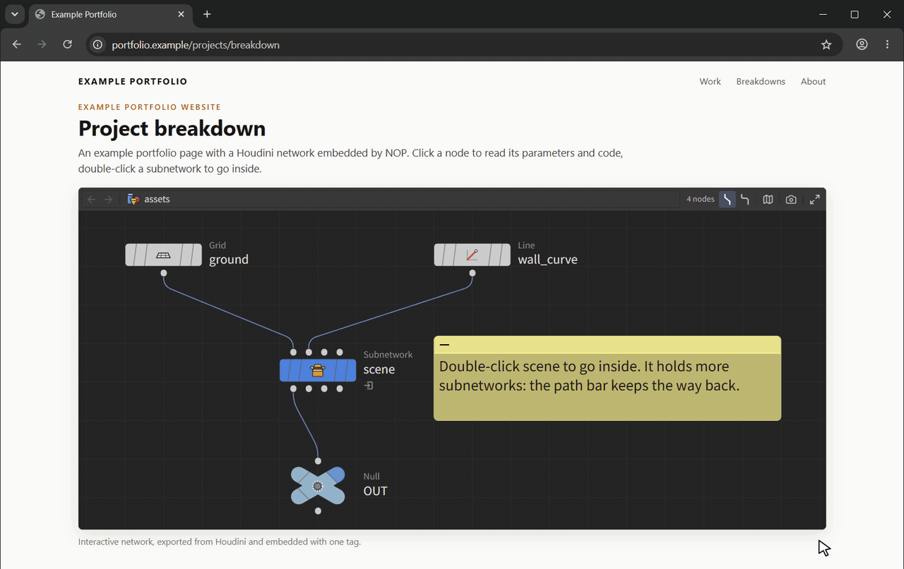

<a href="https://emil-judin.github.io/nop-houdini-network-viewer/"></a>

# NOP

**View and share Houdini node networks on the web.**

**[Open the live playground](https://emil-judin.github.io/nop-houdini-network-viewer/)** | [See it embedded on a web page](https://emil-judin.github.io/nop-houdini-network-viewer/example-site.html) | [Changelog](./CHANGELOG.md)

NOP (Net OPerator) is an interactive, strictly view-only viewer for **SideFX Houdini** node networks on portfolio websites, technical blogs, and documentation, inspired by [Klee](https://joined-forces.github.io/klee/) for Unreal Engine.



---

## What It Does

One click in Houdini exports a network; one tag shows it on your site, looking like Houdini's Network Editor. Visitors can pan, zoom, dive into subnetworks and read parameters and VEX code, on desktop and on phones, but never edit anything.

Six principles guide every change:

1. **Frictionless:** a one-click export in Houdini and a one-line embed on the web.
2. **Authentic:** node shapes, flags, wires and colors match Houdini's Network Editor, checked against Houdini 22 screenshots.
3. **View-only:** visitors explore the network; they cannot change it.
4. **Small, typed modules:** strict TypeScript, React and React Flow, one job per file.
5. **Documented:** public APIs carry TSDoc; lasting decisions are recorded in [`docs/decisions/`](./docs/decisions/README.md).
6. **Works everywhere:** current desktop and mobile browsers, touch-friendly, no experimental web features.

---

## Exporting a Network from Houdini

Click **Get the exporter** at the bottom of the playground's Networks pane to download `nop-exporter.zip`, a Houdini package: copy its contents into the `packages` folder of your Houdini preferences and restart Houdini to get a **NOP** shelf. See [`exporter/README.md`](./exporter/README.md) for the details, a manual shelf tool setup, and binding the dialog-free "copy for web" export to a hotkey such as **Ctrl+Shift+Alt+C**.

---

## Embedding on Your Website

The playground's **Embed** button (at the bottom of the Networks pane) opens its [example page](./example-site.html) in a new tab: it shows an example network on a plain web page, with the options and all three snippets below to copy; the example's file address is filled in and works as it is, and for your own network you put in the address of your uploaded file. The same page embeds two more networks with snippet 1: view its source to copy the pattern.

> **Not on npm yet (tester release).** Snippets 1 and 2 need the npm package (or its CDN copy) and start working with the public release. Until then, use the iframe embed (3).

### 1. Plain HTML / WordPress / Cargo (Web Component)

Upload the exported `.json` file next to your page, then:

```html
<script type="module" src="https://cdn.jsdelivr.net/npm/nop-houdini-network-viewer@0.1.0-alpha.4/dist/web-component.js"></script>

<houdini-network src="my-network.json" style="display: block; height: 600px"></houdini-network>
```

The viewer runs inside a Shadow DOM, so your site's CSS cannot break it and its CSS never touches your site. Instead of `src`, you can put the exported JSON inline (handy for single-file pages, no extra request):

```html
<houdini-network style="height: 600px">
  <script type="application/json">{ "schemaVersion": "1.4.0", "root": { ... } }</script>
</houdini-network>
```

| Attribute | Values | Default |
| :--- | :--- | :--- |
| `src` | URL of the exported `.json` (another site must allow CORS) | none |
| `label-size` | `small`, `medium`, `large` | `medium` |
| `wire-style` | `default` (straight, Houdini's default), `rounded` | as exported (Houdini's wire style setting of that network) |
| `minimap` | `true` (or the bare attribute) opens the network overview at the start | closed (visitors open it with the map button or `O`; never shown in narrow viewers) |
| `focus-node` | name of a node at the top network level to frame at the start, like Houdini's `F` | none: the whole network is fitted |
| `touch-pan` | `two-fingers`: on touch screens one finger scrolls the page, two fingers move the network; `one-finger`: one finger moves the network (for pages the viewer fills). In fullscreen one finger always moves it | `two-fingers` |
| `toolbar` | `false` to hide | shown |
| `fullscreen` | `false` to hide the fullscreen button | shown |
| `inspector` | `false` to never open the Parameter Inspector | enabled |
| `debug-actions` | `true` to show the Download JSON button | hidden |
| `fit-view` | `false` to skip fitting the network on load | fit |
| `hotkeys` | `focus`: Houdini hotkeys only while the viewer has focus; `hover`: also while the pointer is over it; `off` | `focus` |

The element is 480px tall unless you give it a height. From JavaScript you can also set `element.data = json`. The script loads the Parameter Inspector, the SideFX Labs icons and the fonts from files next to it when they are needed, so host the whole `dist/` folder together (the CDN does this for you).

### 2. React / Next.js / Astro (`npm`)

```bash
npm install nop-houdini-network-viewer
```

```tsx
import { HoudiniNetwork } from 'nop-houdini-network-viewer';
import 'nop-houdini-network-viewer/style.css';
import myGraph from './my-network.json';

export function PortfolioBreakdown() {
  return (
    <div style={{ width: '100%', height: '600px' }}>
      <HoudiniNetwork data={myGraph} />
    </div>
  );
}
```

`react` and `react-dom` 18.2+ are peer dependencies (React 19 is not tested yet). To load the file from a URL instead of importing it, use `<RemoteHoudiniNetwork src="/my-network.json" />`. The stylesheet does not reset your page; its classes only style the viewer.

### 3. iframe (ArtStation, Notion, site builders without script tags)

Host the playground (for example on GitHub Pages) and point an iframe at its embed mode. The `.json` needs a full `https://` address that allows cross-origin requests (for example a GitHub Gist raw link):

```html
<iframe
  src="https://<your-playground>/?embed=true&src=https%3A%2F%2Fexample.com%2Fmy-network.json"
  width="100%" height="600" style="border: 0"
  allow="fullscreen" allowfullscreen loading="lazy" title="Houdini node network"
></iframe>
```

The iframe page accepts the same options as URL parameters (`label-size=large`, `minimap=true`, `focus-node=transform1`, ...).

---

## Viewer Controls

| Action | Mouse / keyboard | Touch |
| :--- | :--- | :--- |
| Pan / zoom | Drag with the left or middle mouse button (the middle button never auto-scrolls the page over the viewer) / scroll wheel | Two fingers (one finger scrolls the page); one finger in fullscreen |
| Inspect parameters and VEX | Click a node | Tap a node |
| Dive into a subnetwork | Double-click it, or select it and press `I` | Double-tap it, or tap **Open subnetwork** in the inspector |
| Go up a level | `U`, the arrow button, or a path segment | Arrow button or path segment |
| Resize the parameter panel | Drag its edge (arrow keys when focused, double-click resets) | Drag the grip above the panel |
| Fit all / frame selected | `H` or double-click the empty canvas / `F` | Double-tap the empty canvas |
| Fullscreen | Fullscreen button (`Esc` leaves it); the network is fitted to the new size | Fullscreen button (a full-screen overlay on iPhone) |
| Network overview (minimap) | Click to jump, hold and drag to follow, wheel to zoom; `O` or the map button shows / hides it | Settings menu (gear) > Network overview; starts closed on phone-sized viewers |
| Toggle wire style | `Shift+S` or the two wire buttons | Settings menu (gear) > Wire Style |
| Screenshot (PNG of what the network shows) | Camera button | Settings menu (gear) > Save screenshot |

The node label size is a setting of the page that embeds the viewer (`label-size` attribute or `labelSize` prop), not a visitor control. The fullscreen button can be hidden with `fullscreen="false"` or `showFullscreenButton={false}`.

**On phones:** give the viewer the full screen width and most of its height (for example `height: 70svh`), as the [example page](./example-site.html) does. Narrow viewers get a one-row header without the node count (wire style, overview and screenshot sit in one settings menu), and frame nodes less closely so their names stay on screen.

Keyboard: `Tab` reaches every node (top to bottom), `Enter` opens its parameters, `Esc` closes them again. The single-key hotkeys only react while the viewer has focus (click into it first), so they never interfere with typing elsewhere on the page. The playground also lets them react while the pointer is over the viewer, like Houdini (`hotkeys="hover"`).

---

## Status & Compatibility

**Alpha.** The JSON schema and the component API can still change between `0.x` releases (see [`CHANGELOG.md`](./CHANGELOG.md)).

- **Houdini:** the exporter is checked with Houdini 22.0.466. Houdini 20.5 and 21 are not checked yet.
- **Browsers:** checked in Chromium, Firefox and WebKit, plus Pixel 7, iPhone 14 and iPad device profiles. Safari and Chrome on real phones are targeted but not checked on real devices yet.

---

## Development

Needs Node.js 20 or newer (CI uses Node 22, see `.nvmrc`).

```bash
npm install          # install dependencies
npm run dev          # interactive playground on http://localhost:5173
npm run check        # strict TypeScript
npm run lint         # ESLint (TypeScript, React hooks, accessibility)
npm run build        # playground with the exporter download (dist-playground/)
npm run build:lib    # npm package and web component (dist/)
```

On Windows PowerShell, use `npm.cmd` instead of `npm` if script execution is blocked.

| Read next | |
| :--- | :--- |
| [`docs/ARCHITECTURE.md`](./docs/ARCHITECTURE.md) | Data flow, coordinate conversion, packaging, style isolation |
| [`docs/SCHEMA.md`](./docs/SCHEMA.md) | The JSON format the exporter writes and the viewer reads |
| [`docs/decisions/`](./docs/decisions/README.md) | Architecture decision records |
| [`docs/ROADMAP.md`](./docs/ROADMAP.md) | Current state and what comes next |
| [`CONTRIBUTING.md`](./CONTRIBUTING.md) | Rules for changes |

---

## How It's Built

NOP is built with AI-assisted development, openly. AI coding agents write much of the code; I (Emil Judin) do the work that needs a Houdini artist and a product owner: deciding what NOP should and should not be, making every design and Houdini fidelity call against Houdini 22 screenshots, building and exporting the example networks in Houdini, trying it with real exports and on a phone, and reviewing the changes before they land.

The agents follow written rules that are part of the repository, the same ones a human contributor follows: [`AGENTS.md`](./AGENTS.md) (commands, invariants, security and privacy rules, definition of done), task-specific instructions in [`.agents/skills/`](./.agents/skills/), and the reasons behind the rules in [`docs/decisions/`](./docs/decisions/README.md).

**Contributing with an AI assistant is welcome.** Most coding agents read `AGENTS.md` on their own. Review what your assistant produces as you would your own code: the same checks and the same privacy and "no SideFX assets" rules apply.

---

## Privacy

- **The playground keeps your files in your browser.** Opened, dropped and pasted networks are never uploaded.
- **The feedback form** (only on the hosted playground) sends your message, an optional contact, the NOP version, your browser, the page address without its query and the name of the network on screen, by email through [Web3Forms](https://web3forms.com). Your network file is never sent.
- **The exporter** scrubs paths (see [`docs/SCHEMA.md`](./docs/SCHEMA.md) rule 7) and leaves the insides of locked third-party assets out unless you confirm. Network box comments are exported exactly as written and sticky notes apart from their paths, so check them before sharing.

## Security

Please report vulnerabilities and privacy leaks in exports privately, as described in [`SECURITY.md`](./SECURITY.md).

---

## Disclaimer

This is an independent, community project. It is **not affiliated with, endorsed by, or sponsored by SideFX**. Houdini and SideFX are trademarks of Side Effects Software Inc. Operator icons are original drawings; no SideFX icons, files or code are included or redistributed.

---

## License

MIT License, copyright (c) 2026 Emil Judin. See [`LICENSE`](./LICENSE) for details.

