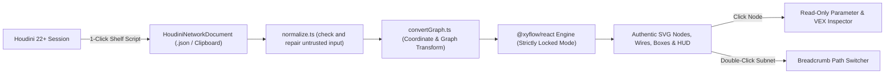
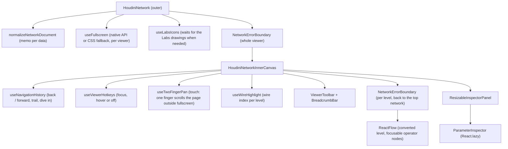

# Architecture Overview (`ARCHITECTURE.md`)

## 1. Design Philosophy

NOP (`nop-houdini-network-viewer`) follows the six core pillars defined once in [AGENTS.md](../AGENTS.md) section 1 (usability, authenticity, strictly view-only, modularity, documentation style, compatibility). This file describes how the code implements them.

The code is split by job: `src/schema/` is pure data logic (normalize, convert, colors), `src/components/` draws the viewer, `src/embed/` loads remote files and parses embed options, `src/playground/` is the demo site, and `exporter/` is the Houdini side. The public API is `src/api.ts` (re-exported with the stylesheet by `src/index.ts`); the playground imports the package only through it, apart from a few listed exceptions (playground helpers and the dev-only icon gallery), which `no-restricted-imports` in `eslint.config.js` enforces.

---

## 2. System Data Flow

---

## 3. Coordinate Space Transformation

Houdini and web browsers use opposite vertical axes and different unit scales:

The constants live in `src/schema/convertGraph.ts` and are pinned by `tests/unit/convertGraph.test.ts`.

| Property | Houdini Network Space | Browser / React Flow Space | Conversion Formula (`HOUDINI_UNIT_TO_PX = 100`) |
| :--- | :--- | :--- | :--- |
| **X Axis** | Positive X is Right (in network units) | Positive X is Right (in pixels) | `screenX = houX * 100` |
| **Y Axis** | Positive Y is UP (Cartesian) | Positive Y is DOWN (Screen) | `screenY = -houY * 100` |
| **Operator Node Size** | `hou.Node.size()` reports `[1.1296, 0.2824]` | Always Houdini's 10:3 shape box, `100px x 30px` (`node.size` is informational) | `y = -(pos[1] + 0.3) * 100` |
| **Box / Sticky Origin** | Bottom-Left corner `(pos[0], pos[1])` | Top-Left corner `(x, y)` | `y = -(pos[1] + size[1]) * 100` |
| **Network Box Header** | Not part of `pos` / `size` (Houdini fits them around the items) | `29px` header drawn above the body (`MINIMIZED_BOX_HEIGHT_PX`) | `y = -(pos[1] + size[1]) * 100 - 29` |
| **Minimized Box** | `size[1]` reports `0.0` | Header only, `29px` high | `y = -pos[1] * 100 - 29` |
| **Minimized Sticky** | | Header only, `22px` high (`MINIMIZED_STICKY_HEIGHT_PX`) | `y = -pos[1] * 100 - 22` |
| **Network Dot** | Center point `(pos[0], pos[1])` | `19px` disc, radius `9.5px` (`HOUDINI_DOT_RADIUS_PX`) | `x = pos[0] * 100 - 9.5`, `y = -pos[1] * 100 - 9.5` |

React Flow IDs: operator nodes use their Houdini name; boxes, stickies, dots, subnet inputs and For-Each / Compile block underlays get the prefixes `box:`, `sticky:`, `dot:`, `input:` and `block:` (Houdini never allows a colon in names), so items of different kinds never collide.

---

## 4. Packaging & Embedding Modes

`npm.cmd run build:lib` builds both library outputs into `dist/` (`vite.lib.config.ts`, two modes) and the type declarations into `dist/types/` (`tsconfig.lib.json`). `npm.cmd run build` builds the Houdini exporter package (`npm.cmd run build:exporter`: `public/downloads/nop-exporter.zip` from `exporter/package/` and `exporter/nop_exporter.py`) and then the playground into `dist-playground/`, which `.github/workflows/deploy-playground.yml` publishes to GitHub Pages on every push to `main`. The playground build also publishes the example networks at `examples/<name>-network.json` and the web component from `dist/` at `lib/` (`exampleSiteFiles` in `vite.config.ts`), for the embed snippets and `public/example-site.html`, so `build:lib` runs before `build`. Examples are listed in `src/playground/examples.ts`; one whose file is missing is left out.

1. **React Component (`src/index.ts`, `--mode npm`):**
   `dist/index.js` (ES) and `dist/index.cjs` export `<HoudiniNetwork data={...} />`, `<RemoteHoudiniNetwork src="..." />`, the schema types and the converter. `react` and `react-dom` are peer dependencies; `@xyflow/react` and `lucide-react` stay external. Styles ship separately as `dist/style.css` (`nop-houdini-network-viewer/style.css`).
2. **Web Component (`src/web-component.ts`, `--mode web-component`):**
   `dist/web-component.js` is a minified ES module (React included, about 176 KB gzipped) that registers `<houdini-network>`. Optional parts load on demand from `dist/web-component-chunks/` next to it: the Parameter Inspector (about 9 KB, when a node is selected) and the SideFX Labs icon drawings (about 24 KB, only for networks with Labs tools). Fonts are separate files in `dist/fonts/`, registered in the page head with URLs made absolute from the script's own URL. The viewer renders inside an open **Shadow DOM**, so host page CSS never reaches the nodes and the viewer CSS never reaches the page. The network comes from the `data` property, an inline `<script type="application/json">` child (parsed once per text, and re-read when page scripts change it), or the `src` attribute (in that order). Viewer options are attributes (`label-size`, `wire-style`, `minimap`, `toolbar`, `inspector`, `debug-actions`, `fit-view`, `hotkeys`), parsed by `src/embed/embedAttributes.ts`.
3. **Iframe Embed Mode (`?embed=true`):**
   `src/playground/EmbedView.tsx` renders only the viewer, loading `src=<url>` (or `demo=<example key>`, see `examples.ts`) with the same option names as the web component. A file from another site gets a small "Network from <host>" caption, so a link cannot pass off foreign content as the NOP site's. `main.tsx` lazy-loads either the embed view or the playground, so an embed never downloads the demo networks or the icon gallery. Used on platforms like ArtStation and Notion where script tags are not allowed.

Remote files go through `src/embed/fetchNetwork.ts`: no credentials to other sites, at most 100 MB and 30 seconds, and readable errors (wrong path, CORS, HTML page instead of JSON). The hosted playground also sends a Content-Security-Policy meta tag (`vite.config.ts`).

---

## 5. Styles & Isolation (`src/styles/`)

The viewer is styled with Tailwind utility classes, but the library must not restyle the host page and must survive hostile host CSS:

| File | Contents | Used by |
| :--- | :--- | :--- |
| `theme.css` | Font tokens; spacing, text, radius and container sizes pinned to `px` (Tailwind defaults to `rem`, which follows the host's root font size even inside a Shadow DOM) | all |
| `fonts.css` | `@font-face` for Source Sans Pro / Source Code Pro (Latin, WOFF2; the library build moves the font files to `dist/fonts/`, plugin `emitFontFiles`) | all (the web component injects it into the page head, because browsers ignore `@font-face` inside a Shadow DOM) |
| `viewer.css` | React Flow base CSS and viewer overrides (transparent nodes, `color-scheme: dark`) | all |
| `reset.css` | Minimal reset scoped to `.nop-root` instead of Tailwind's global preflight; single-class specificity (`:where()`), so it beats host `button {}` rules but loses to utilities | library builds |
| `viewer-bundle.css` | theme + reset + viewer + only the utilities used in `src/components` and `src/embed` (unlayered, so host CSS cannot outrank it through cascade layers) | web component (Shadow DOM) |
| `library.css` | fonts + `viewer-bundle.css` | npm `style.css` (scoped at build time, see below) |

The npm `style.css` has no Shadow DOM around it, so `vite.lib.config.ts` (`scopeStylesheetToViewer`) rewrites every selector at build time to only match inside the viewer: utilities and React Flow rules become `:is(.nop-root, .nop-root *).class`, rules that start with `.nop-root` get one more `.nop-root`, type selectors become `.nop-root svg...`, and the theme variables move from `:root` to `.nop-root`. Every rule gains exactly one class of specificity, so the order between the viewer's own rules is unchanged, while a host page's same-named Tailwind classes, its theme variables and its other React Flow diagrams are no longer affected. Consequence: **every viewer element must render inside a `.nop-root` element** (no portals to `document.body`), or it gets no styles in the npm build.

Inside the Shadow DOM, Tailwind's `@property` initial values are ignored, so `web-component.ts` sets them directly (`buildShadowPropertyDefaults`); without this, borders and shadows would vanish. The playground keeps using normal Tailwind (with preflight) plus `theme.css`, `fonts.css` and `viewer.css`.

---

## 6. Viewer Component Tree

Selection, keyboard focus and the remembered viewport of every visited level live in the inner canvas. Going up selects the subnetwork you came from; keyboard users keep focus inside the viewer across navigation.

---

## 7. Inspection & Navigation

- **Parameter Inspector (`src/components/inspector/`):** mirrors the Houdini 22 Parameter Pane (colors sampled from a Houdini screenshot, `paneStyles.ts`).
  - `parmModel.ts` turns the exported parameter tuples into a layout tree: tab bars (`tabs` / `radio` folders), section bands (`simple`, `collapsible`, `multiparm`), and lines that hold one parameter or several joined ones. Folders collect their parameters wherever they appear in the list.
  - `ParmLayoutView.tsx` draws tabs (WAI-ARIA tabs with arrow keys) and sections; `ParmLine.tsx` draws a row as a named group (gutter toggle, right-aligned label column, value widgets: fields, menus with the blue-grey arrow button, sliders from `range`, toggles, string menu buttons, separators; teal when expression driven or keyframed, greyed and `aria-disabled` when `disabled`). A click or tap on a cut-off value shows it in full. Buttons are never exported.
  - `CodeBlock.tsx` + `codeHighlight.ts` highlight VEX and Python with a Copy button.
  - `ResizableInspectorPanel.tsx`: side panel when the viewer is at least 672px wide (measured with `useElementSize`, not the page width), bottom sheet below that. A drag handle (pointer events, so mouse, touch and pen; arrow keys when focused; double-click resets) resizes it sideways or up and down, and the size is remembered in `localStorage`.
- **Subnetwork navigation (`src/schema/subnetPath.ts`, `src/components/hooks/useNavigationHistory.ts`, `src/components/hud/BreadcrumbBar.tsx`):** the viewer keeps a dive path of subnetwork names from the exported root, with back / forward history and Houdini's dimmed trail of deeper visited levels. Double-click or double-tap a node with exported `children` (or press `I`, or use the inspector's Open subnetwork button) to dive in; `U`, the back button or a path segment goes back. Each level's viewport is remembered, and going up selects the subnetwork you came from, like Houdini.
- **Keyboard:** Tab reaches every operator node (top to bottom, announced as "Type node name"), Enter or Space opens its parameters and moves focus to the inspector heading, Escape closes the inspector and returns focus to the node. Single-key hotkeys only act while focus is inside the viewer (`hotkeys="focus"`, the default), so they never fire while the visitor types elsewhere on the host page.

