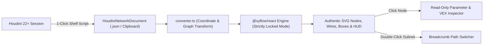

# Architecture Overview (`ARCHITECTURE.md`)

## 1. Design Philosophy & The 6 Pillars

WOP (`wop-houdini-network-viewer`) is architected around six core principles:
1. **Usability:** Minimal steps from Houdini to a live webpage (1-click Python shelf export to clipboard or file, 1-tag embed on the web).
2. **Authenticity:** 1:1 visual fidelity with SideFX Houdini's Network Editor.
3. **Strictly View-Only:** The viewer is an inspection tool, not an editor. Nodes cannot be dragged (`nodesDraggable={false}`), wires cannot be created or deleted (`nodesConnectable={false}`, `edgesReconnectable={false}`), and flags/parameters are strictly read-only indicators.
4. **Modularity & Readability:** Clean separation between the data contract (`src/schema/`), visual node/edge components (`src/components/`), and the demo playground (`src/playground/`).
5. **Documentation & Neutral Styling:** Every exported symbol uses TSDoc comments. Documentation, comments, and UI strings use neutral international English punctuation without em-dashes.
6. **Compatibility:** Base layout and display settings work in Android and iOS views (responsive, touch pan and pinch-zoom), and the viewer runs on current versions of all major modern browsers using only broadly supported (Baseline) web features with graceful fallbacks.

---

## 2. System Data Flow

---

## 3. Coordinate Space Transformation

Houdini and web browsers use opposite vertical axes and different unit scales:

| Property | Houdini Network Space | Browser / React Flow Space | Conversion Formula (`UNIT_SCALE = 100`) |
| :--- | :--- | :--- | :--- |
| **X Axis** | Positive X is Right (in network units) | Positive X is Right (in pixels) | `screenX = houX * 100` |
| **Y Axis** | Positive Y is UP (Cartesian) | Positive Y is DOWN (Screen) | `screenY = -houY * 100` |
| **Standard SOP Size** | `[1.1296, 0.2824]` units | `113px x 28px` | `width = size[0] * 100`, `height = size[1] * 100` |
| **Node / Box Origin** | Bottom-Left corner `(pos[0], pos[1])` | Top-Left corner `(x, y)` | `y = -(pos[1] + size[1]) * 100` |
| **Minimized Box** | `size[1]` reports `0.0` in Houdini | Compact header bar (`28px` height) | `y = -pos[1] * 100 - 28`, `height = 28` |
| **Network Dot** | Center point `(pos[0], pos[1])` | Top-Left of `12px x 12px` dot | `x = pos[0] * 100 - 6`, `y = -pos[1] * 100 - 6` |

---

## 4. Packaging & Embedding Modes

`npm.cmd run build:lib` builds both library outputs into `dist/` (`vite.lib.config.ts`, two modes) and the type declarations into `dist/types/` (`tsconfig.lib.json`). `npm.cmd run build` builds the Houdini exporter package (`npm.cmd run build:exporter`: `public/downloads/wop-exporter.zip` from `exporter/package/` and `exporter/wop_exporter.py`) and then the playground into `dist-playground/`, which `.github/workflows/deploy-playground.yml` publishes to GitHub Pages on every push to `main`.

1. **React Component (`src/index.ts`, `--mode npm`):**
   `dist/index.js` (ES) and `dist/index.cjs` export `<HoudiniNetwork data={...} />`, `<RemoteHoudiniNetwork src="..." />`, the schema types and the converter. `react` and `react-dom` are peer dependencies; `@xyflow/react` and `lucide-react` stay external. Styles ship separately as `dist/style.css` (`wop-houdini-network-viewer/style.css`).
2. **Web Component (`src/web-component.ts`, `--mode web-component`):**
   `dist/web-component.js` is one self-contained, minified ES module (React included, about 260 KB gzipped) that registers `<houdini-network>`. The viewer renders inside an open **Shadow DOM**, so host page CSS never reaches the nodes and the viewer CSS never reaches the page. The network comes from the `data` property, an inline `<script type="application/json">` child, or the `src` attribute (in that order). Viewer options are attributes (`label-size`, `wire-style`, `minimap`, `toolbar`, `inspector`, `debug-actions`, `fit-view`), parsed by `src/embed/embedAttributes.ts`.
3. **Iframe Embed Mode (`?embed=true`):**
   `src/playground/EmbedView.tsx` renders only the viewer, loading `src=<url>` (or `demo=circuit|simple`) with the same option names as the web component. `main.tsx` lazy-loads either the embed view or the playground, so an embed never downloads the demo networks or the icon gallery. Used on platforms like ArtStation and Notion where script tags are not allowed.

---

## 5. Styles & Isolation (`src/styles/`)

The viewer is styled with Tailwind utility classes, but the library must not restyle the host page and must survive hostile host CSS:

| File | Contents | Used by |
| :--- | :--- | :--- |
| `theme.css` | Font tokens; spacing, text, radius and container sizes pinned to `px` (Tailwind defaults to `rem`, which follows the host's root font size even inside a Shadow DOM) | all |
| `fonts.css` | `@font-face` for Source Sans Pro / Source Code Pro (Latin, WOFF2) | all (the web component injects it into the page head, because browsers ignore `@font-face` inside a Shadow DOM) |
| `viewer.css` | React Flow base CSS and viewer overrides (transparent nodes, `color-scheme: dark`) | all |
| `reset.css` | Minimal reset scoped to `.wop-root` instead of Tailwind's global preflight; single-class specificity (`:where()`), so it beats host `button {}` rules but loses to utilities | library builds |
| `viewer-bundle.css` | theme + reset + viewer + only the utilities used in `src/components` and `src/embed` (unlayered, so host CSS cannot outrank it through cascade layers) | web component (Shadow DOM) |
| `library.css` | fonts + `viewer-bundle.css` | npm `style.css` (scoped at build time, see below) |

The npm `style.css` has no Shadow DOM around it, so `vite.lib.config.ts` (`scopeStylesheetToViewer`) rewrites every selector at build time to only match inside the viewer: utilities and React Flow rules become `:is(.wop-root, .wop-root *).class`, rules that start with `.wop-root` get one more `.wop-root`, type selectors become `.wop-root svg...`, and the theme variables move from `:root` to `.wop-root`. Every rule gains exactly one class of specificity, so the order between the viewer's own rules is unchanged, while a host page's same-named Tailwind classes, its theme variables and its other React Flow diagrams are no longer affected. Consequence: **every viewer element must render inside a `.wop-root` element** (no portals to `document.body`), or it gets no styles in the npm build.

Inside the Shadow DOM, Tailwind's `@property` initial values are ignored, so `web-component.ts` sets them directly (`buildShadowPropertyDefaults`); without this, borders and shadows would vanish. The playground keeps using normal Tailwind (with preflight) plus `theme.css`, `fonts.css` and `viewer.css`.

---

## 6. Inspection & Navigation

- **Parameter Inspector (`src/components/inspector/`):** mirrors the Houdini 22 Parameter Pane (colors sampled from a Houdini screenshot, `paneStyles.ts`).
  - `parmModel.ts` turns the exported parameter tuples into a layout tree: tab bars (`tabs` / `radio` folders), section bands (`simple`, `collapsible`, `multiparm`), and lines that hold one parameter or several joined ones. Folders collect their parameters wherever they appear in the list.
  - `ParmLayoutView.tsx` draws tabs and sections; `ParmLine.tsx` draws a row (gutter toggle, right-aligned label column, value widgets: fields, menus with the blue-grey arrow button, sliders from `range`, toggles, string menu buttons, separators, buttons; dark teal when expression driven, dark green when keyframed, greyed when `disabled`).
  - `CodeBlock.tsx` + `codeHighlight.ts` highlight VEX and Python with a Copy button.
  - `ResizableInspectorPanel.tsx`: side panel when the viewer is at least 672px wide (measured with `useElementSize`, not the page width), bottom sheet below that. A drag handle (pointer events, so mouse, touch and pen; arrow keys when focused; double-click resets) resizes it sideways or up and down, and the size is remembered in `localStorage`.
- **Subnetwork navigation (`src/schema/subnetPath.ts`, `src/components/hud/BreadcrumbBar.tsx`):** the viewer keeps a dive path of subnetwork names from the exported root. Double-click or double-tap a node with exported `children` (or press `I`, or use the inspector's Open subnetwork button) to dive in; `U`, the Up button or a breadcrumb segment goes back. Each level's viewport is remembered, and going up selects the subnetwork you came from, like Houdini.

